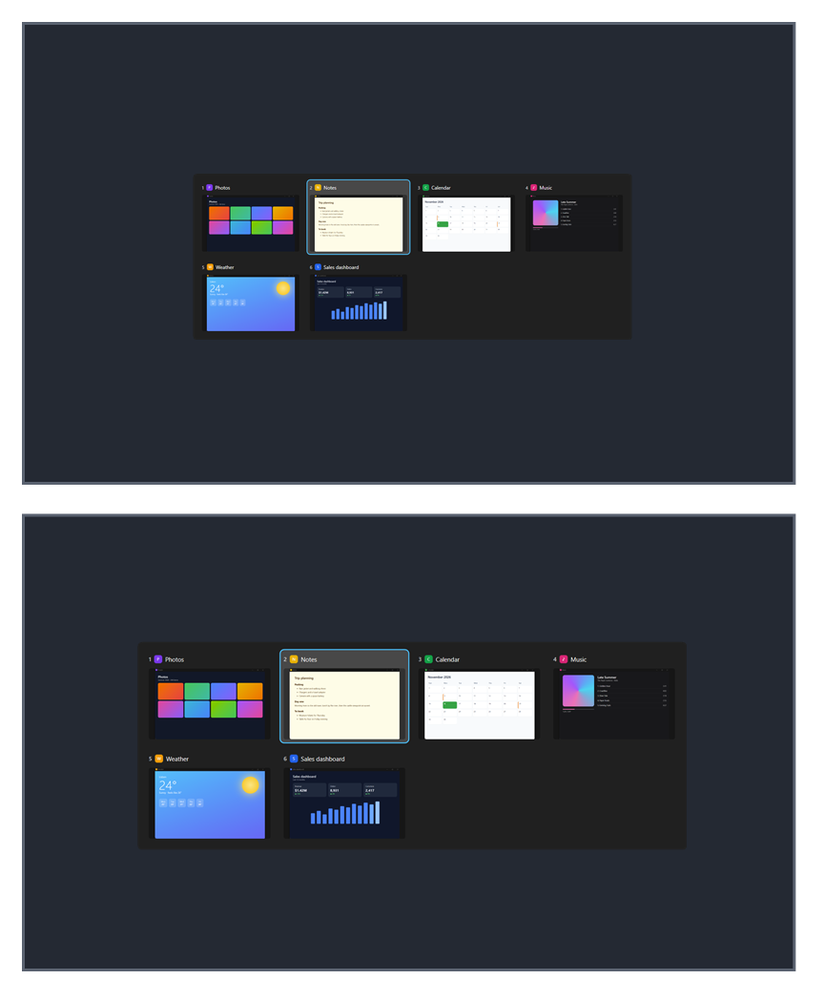
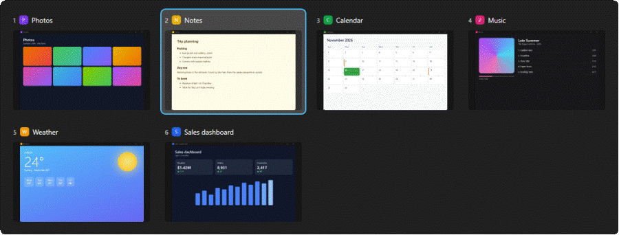

# AltTab Everywhere

An Alt+Tab switcher for Windows 11 that appears on **every monitor at once**. Windows' own switcher only ever shows on the main display.



> Status: **early (v0.6)**. Works day to day. Settings can be changed in a settings window or in a JSON file.

Three rules guide every feature:
1. **Lowest resource use possible.** When idle it does no work (0 ms of CPU) and uses about 10–16 MB working set (about 40–50 MB private). The switcher appears about 110–130 ms after Alt+Tab. See [Resource use](#resource-use).
2. **As many configuration options as possible.** See [Settings](#settings).
3. **Open source, built on your machine.** Everything you run, you built from code you can read; ready-made downloads exist only for convenience. No telemetry: the app never goes online unless you turn on the update check.

See [ROADMAP.md](ROADMAP.md) for what's next.

## Install

### Build it on your PC (recommended)

Everything you run, you built from code you can read. You need Windows 10 or 11, [Git](https://git-scm.com/) and the [.NET 10 SDK](https://dotnet.microsoft.com/download/dotnet/10.0).

```bash
git clone https://github.com/karanshah229/alttab-everywhere.git
```

```bash
cd alttab-everywhere
```

```bash
powershell -ExecutionPolicy Bypass -File install.ps1
```

It builds the app and installs it for you in `%LOCALAPPDATA%\Programs\AltTab Everywhere`, with no admin rights, then starts it. Turn on **Start with Windows** from its tray icon to keep it running. Run it again after `git pull` to update; your settings are kept.

**Working over administrator windows too.** While a window running as administrator (an admin terminal, say) has focus, Windows keeps the keyboard from every app that isn't elevated, so its own Alt+Tab appears. Windows lets a switcher past that only if it is signed and installed under Program Files. Instead of buying a certificate, this signs it on your own PC:

```bash
powershell -ExecutionPolicy Bypass -File install.ps1 -AdminWindows
```

With one administrator prompt it builds the `uiAccess` version, installs it in `C:\Program Files\AltTab Everywhere`, creates a code-signing certificate for this PC only, trusts it on this PC, signs the app, and **deletes the certificate's private key straight away**, so nothing else can ever be signed with it. Each run makes a fresh certificate and removes the previous one.

To remove it (and the certificate, if any); add `-RemoveSettings` to delete your settings and log too:

```bash
powershell -ExecutionPolicy Bypass -File uninstall.ps1
```

### Ready-made downloads

For convenience, each [release](https://github.com/karanshah229/alttab-everywhere/releases) also has zips built by GitHub from the same code. They aren't signed, so Windows SmartScreen warns the first time you run one (**More info** → **Run anyway**), and they can't work over administrator windows.

- **`AltTabEverywhere-<version>-win-x64.zip`** (or `-win-arm64` for Arm PCs): about 250 KB. Needs the [.NET 10 Desktop Runtime](https://dotnet.microsoft.com/download/dotnet/10.0), which it shares with other apps, so it's the lightest choice.
- **`…-selfcontained.zip`**: one exe with .NET inside (about 65 MB) for PCs without the runtime.

Unzip it anywhere and run `AltTabEverywhere.exe`. `SHA256SUMS.txt` lists each zip's checksum. Once the winget package is accepted: `winget install AltTabEverywhere.AltTabEverywhere`.
## Run without installing (development)

Requires the .NET 10 SDK on Windows 10 or 11.

```bash
dotnet run --project src/AltTabEverywhere
```

The app runs in the notification area, with no main window. Right-click its tray icon to:
- **pause** it (untick **Enabled**);
- turn **Start with Windows** on or off. This uses a per-user startup entry and needs no admin rights; it also shows in Windows Settings > Apps > Startup;
- open **Settings…** (or double-click the icon), **edit the settings file**, **open the log folder**, or **exit**.

If the app closes or crashes, Windows' own Alt+Tab takes over again straight away. After sleep, unlock or a display change, the app re-installs its keyboard hook automatically, in case Windows dropped it.

To test without the keyboard, run it with `--demo`. It opens the switcher on every monitor for 4 seconds, writes the overlay layout to the log, and exits. Options: `--demo-seconds N` (how long it stays open), `--demo-defaults` (ignore settings.json and use the defaults), `--demo-since TIME` (only windows of processes started at or after an ISO 8601 UTC time; the screenshot script uses it to show its sample windows only) and `--demo-tour MS` (move the selection one tile every MS milliseconds):

```bash
dotnet run --project src/AltTabEverywhere -- --demo
```

Log file: `%LOCALAPPDATA%\AltTabEverywhere\log.txt`. It records counts and layout only, never window titles. At 1 MB it rolls over to `log.1.txt`, so it never grows past about 2 MB.

The app icon (`src/AltTabEverywhere/Assets/app.ico`) is drawn in code, one pixel grid per size. To change it, edit `tools/IconGen/Program.cs` and run:

```bash
dotnet run --project tools/IconGen
```

## Keys



| Keys | Action |
|---|---|
| Alt+Tab / Alt+Shift+Tab | Open the switcher, then move forward or back. Add more shortcuts with [`shortcuts`](#shortcuts) |
| ← / → | Previous / next tile |
| ↑ / ↓ | Row up / down, wrapping around. Every monitor uses the same grid, so a row is a row on every screen |
| Home / End | First / last tile |
| Page Up / Page Down | A screenful of rows up or down, stopping at the top and bottom |
| 1–9 | Switch to that tile (the number shows on the tile). Set `numberKeys` to `"select"` or `"off"` |
| Type letters | Search titles and app names; the tiles filter as you type. Works while holding Alt |
| Backspace | Remove the last typed character. With nothing typed, in an open stack: go back to every window |
| Pause on a stack, Alt+`, or click its badge | In stacked mode: open the selected app's stack. Its windows become the tiles, after a **Back** tile, and the window the stack showed stays selected, so letting go of Alt still picks it. Pausing on Back (or Enter, a click, or Backspace) shows every window again. ` is the key above Tab, whatever symbol your keyboard layout puts on it; in an open stack it moves to the next window |
| Release Alt, or press Enter | Switch to the selected window. Releasing Alt on Back switches nowhere, like Esc |
| Esc | Clear the search; with no search, close without switching |
| Delete | Close the selected window. The app can still ask to save. The switcher stays open |
| Click a tile | Switch to that window |
| Ctrl+Enter (`moveHereKey`) | Switch to the selected window **and bring it to this monitor**: the one whose switcher the keyboard drives (under the mouse, by default). It keeps its size and relative place, and a maximized window is maximized there |
| Ctrl+click a tile | Switch to that window and bring it to the monitor of the switcher you clicked. With a switcher on every screen, that pulls any window to where you are |
| Ctrl+Down (`minimizeKey`) | Minimize the selected window, or restore it (without switching) if it's minimized. The switcher stays open |
| Ctrl+Up (`maximizeKey`) | Switch to the selected window maximized, or restored if it already was |
| Ctrl+T (`alwaysOnTopKey`) | Keep the selected window above other windows, or stop. The switcher stays open; a pin badge shows it |
| Ctrl+Shift+Q (`quitAppKey`) | Quit the selected window's app: every listed window of that app is asked to close (apps can still ask to save). The switcher stays open |
| Right-click a tile | A menu with all of these actions and their keys: switch to, move to this monitor, minimize, maximize, always on top, close window, quit app |
| Middle-click a tile, or click its × | Close that window |
| Mouse wheel | Scroll, when there are more windows than fit |
| Click outside the switcher | Close it |

A quick Alt+Tab tap switches to the previous window straight away. The switcher appears as soon as it's drawn; set `showDelayMs` if you'd rather quick taps never show it.

While searching, 1–9 type digits instead of switching. To search for something that starts with a digit, type a letter first or turn `numberKeys` off. Ctrl and Win combinations are never taken over by the search.

The switcher takes at most 75% of a monitor's width and 75% of its height. With many windows, tiles first shrink slightly (to 75% of their size at most); after that the grid scrolls inside the switcher, and the selection always stays in view.

## Settings

Double-click the tray icon, or right-click it and choose **Settings…**, to open the settings window. Every setting below is there, in tabs (Shortcuts, Behaviour, Filters, Navigation, Closing, Appearance, System), and each change is saved and applied straight away. The Behaviour tab holds the defaults every shortcut uses; a shortcut's **More options** can override them for that shortcut alone. **Reset tab to defaults**, next to **Open settings.json**, resets the settings on the open tab. Colours can be typed as `#RRGGBB` or picked from a palette (with **More colours…** for any colour). The window uses the switcher's own colours: its theme, background, text colour and accent. It runs as its own short-lived process (`AltTabEverywhere.exe --settings`, which you can also pin as a shortcut), so the always-on switcher never holds its memory: closing the window frees all of it. Opening it takes about 1.5 seconds.

Settings live in `%APPDATA%\AltTabEverywhere\settings.json`, created with defaults on first run. To edit the file by hand, choose **Edit settings file…** in the tray menu. Changes apply as soon as you save. If the file has a mistake, the switcher keeps your previous settings and writes the error to the log. Comments and trailing commas are allowed. The settings window and the tray toggles change one key at a time and keep every other key as you wrote it, but not comments.

<a id="shortcuts"></a>**Shortcuts**

| Key | Default | Meaning |
|---|---|---|
| `shortcuts` | `[{ "keys": "Alt+Tab" }]` | The key combinations that open the switcher. Each can have its own filters (below). Hold the modifiers and press the key again to move on; releasing all the modifiers switches |

Each entry has `keys` and, optionally, any of these. Anything left out uses the global setting:

| Entry key | Meaning |
|---|---|
| `keys` | Modifiers (`Alt`, `Ctrl`, `Shift`, `Win`) and one key: `Tab`, `Space`, `` ` `` (the key above Tab), `A`–`Z`, `0`–`9`, `F1`–`F24`. At least one of Alt, Ctrl or Win. Examples: `"Alt+Tab"`, `"Win+Tab"`, `"Ctrl+Alt+Tab"`, ``"Alt+`"`` |
| `windows` | `"all"` (default) or `"currentApp"`: only the windows of the app that had focus, one tile each, like Cmd+` on macOS or Alt+` on GNOME |
| `showOn`, `listWindowsFrom`, `virtualDesktops`, `groupWindows`, `stayOpenAfterAltRelease`, `layout`, `sortOrder` | Override that setting for sessions this shortcut opens |

Shift reverses direction, unless Shift is part of the shortcut. A shortcut that Windows also uses (`Win+Tab` for Task View, `Ctrl+Alt+Tab` for its sticky switcher) is taken over while the app runs. Invalid or repeated entries are skipped and named in the log; if none is valid, Alt+Tab is used.

**When and where it appears**

| Key | Default | Meaning |
|---|---|---|
| `showDelayMs` | `0` | Wait this long before showing the switcher, so taps shorter than this switch without it appearing. `0` shows it as soon as it's drawn |
| `showOn` | `"allMonitors"` | Which monitors show a switcher: `"allMonitors"`, `"monitorUnderCursor"`, or `"monitorWithActiveWindow"` (the one with the window that had focus). The keyboard always drives the switcher on the monitor under the mouse, or, with `monitorWithActiveWindow`, on that monitor |
| `stayOpenAfterAltRelease` | `false` | Keep the switcher open after you release the shortcut's modifier keys (Alt for Alt+Tab, Shift and Win for Shift+Win+Tab). Choose with Enter or a click, move with Tab or the arrow keys, close with Esc. A quick tap still switches immediately |

**Which windows are listed**

| Key | Default | Meaning |
|---|---|---|
| `listWindowsFrom` | `"allMonitors"` | `"allMonitors"`: every switcher lists every window. `"thisMonitor"`: each monitor's switcher lists only the windows on that monitor. Click a tile on any screen to switch to it. If the monitor you're using has no windows, its switcher lists all of them so Alt+Tab still works |
| `virtualDesktops` | `"current"` | `"current"` or `"all"`. Windows on other desktops show their icon instead of a preview |
| `groupWindows` | `"separate"` | `"separate"`: one tile per window. `"stacked"`: one tile per app, with a ×N badge; open a stack to pick one of its windows (see `stackOpenDelayMs`). A shortcut with `"windows": "currentApp"` always lists one tile per window. Apps are told apart by their shell app ID, so Chrome profiles stay separate |
| `sortOrder` | `"recent"` | Tile order. `"recent"`: most recently used first, like Windows. `"stacking"`: front to back as the windows are stacked on screen. `"app"`: by app name, most recent first within each app. `"title"`: by window title, A to Z. `"monitor"`: one run of tiles per screen, left to right, most recent first within each. Whatever the order, Alt+Tab still starts on the window you used before the current one (Shift+Alt+Tab on the least recent). With stacks, a stack sorts by its most recent window. The lookups an order needs (stacking order, app names, monitors) are only made for that order, when the switcher opens (about 2–3 ms for "app") |
| `stackOpenDelayMs` | `500` | In stacked mode, pausing this long on a stack opens it, and pausing this long on its Back tile goes back. 0–5000; 0 turns pausing off (Alt+` and the badge still open a stack, and Enter, a click or Backspace on Back still go back). The timer only runs while the switcher is open and a stack (or Back) is selected, and never while you're typing a search |
| `peek` | `"outline"` | `"outline"`: while the switcher is open, a coloured ring is drawn over the edge of the selected window, wherever it is, so you can see which window will come forward (handy on several screens). It sits on top of other windows but under the switcher. Minimized windows and windows on other desktops have no outline. `"off"`: no outline |
| `peekDelayMs` | `0` | Resting on a tile this long before its outline appears; the outline is hidden while the selection moves. 0–5000 |
| `peekBorderWidth` | `4` | Thickness of the outline, in device-independent pixels (scaled for each monitor). 1–20 |
| `peekColor` | `""` | Outline colour as `"#RRGGBB"`; empty uses the accent colour |
| `showDesktopTile` | `false` | A **Show desktop** tile after the windows, on every switcher. Picking it (Enter, a click, letting go of Alt, or its number) closes the switcher and shows the desktop, like Win+D, through the shell's `ToggleDesktop`; if the desktop already had focus it simply stays. A session never starts on it, Delete doesn't close it, and while searching it's listed only if "Show desktop" matches what you typed |
| `moveHereKey` | `"Ctrl+Enter"` | While the switcher is open, this key switches to the selected window and moves it to the monitor whose switcher the keyboard drives. Same size (shrunk only if it doesn't fit) and the same relative place, like Win+Shift+Arrow; maximized windows are maximized there and minimized ones restored there. Accepts Enter, Insert, Space, F1–F24 or a letter, with Shift and/or Ctrl (a letter takes that letter away from the search). `"off"` turns it off. Not Shift+Enter by default: Shift is often still held after Shift+Alt+Tab, and a stray Enter would move the window. Frozen windows, and windows running as administrator unless this app is too, can't be moved; they're just switched to. Every move is logged with what triggered it |
| `ctrlClickMovesHere` | `true` | Ctrl+click on a tile switches to that window and moves it to the monitor of the switcher you clicked |
| `minimizeKey` | `"Ctrl+Down"` | While the switcher is open: minimize the selected window, or restore it without switching if it's minimized. The switcher stays open and the tile updates. Same key format as `moveHereKey`; `"off"` turns it off |
| `maximizeKey` | `"Ctrl+Up"` | Switch to the selected window maximized, or restored if it already was maximized |
| `alwaysOnTopKey` | `"Ctrl+T"` | Turn always-on-top on or off for the selected window; the switcher stays open, and above it. Windows running as administrator refuse unless this app is too |
| `quitAppKey` | `"Ctrl+Shift+Q"` | Ask every listed window of the selected window's app to close, like clicking each one's ×. Apps can still ask to save; nothing is force-killed |
| `tileMenu` | `true` | Right-clicking a tile opens a menu of the window actions, each showing its key. Built only when opened |
| `excludedApps` | `[]` | Apps never listed. Each entry can be an executable name (`"notepad.exe"` or `"notepad"`), a full path, or a shell app ID (see `--list`) |
| `excludedTitles` | `[]` | Windows never listed if their title contains any of these. Not case-sensitive |

**Finding windows**

| Key | Default | Meaning |
|---|---|---|
| `typeToSearch` | `true` | Typing while the switcher is open filters the tiles by window title and app name. Every typed word must match; the best matches come first, and equal matches keep most-recent-first order |
| `searchMode` | `"fuzzy"` | `"fuzzy"`: letters in order with gaps allowed (`wtm` finds Windows Terminal). `"contains"`: each word must appear as typed |
| `numberKeys` | `"switch"` | What 1–9 do before anything is typed: `"switch"` to that tile's window, `"select"` it, or `"off"` (digits go to the search) |
| `showTileNumbers` | `true` | Show 1–9 on the first nine tiles (when `numberKeys` isn't `"off"`) |
| `hoverSelects` | `false` | Moving the mouse over a tile selects it. Only real mouse movement counts, so tiles scrolling under a still pointer don't steal the selection |
| `screenReaderAnnouncements` | `true` | Screen readers (Narrator, NVDA, JAWS) read each tile as it's selected: its title, how many windows a stack holds, its states (not responding, running as administrator...) and its place ("3 of 12"). Done by moving keyboard focus with the selection inside the switcher, which costs nothing when no screen reader is running. When a search matches nothing, "No windows match" is announced |

**Closing windows**

| Key | Default | Meaning |
|---|---|---|
| `deleteKeyCloses` | `true` | Delete closes the selected window |
| `middleClickCloses` | `true` | Middle-click on a tile closes that window |
| `showCloseButton` | `true` | Show a × on the tile under the mouse |

**Appearance**

| Key | Default | Meaning |
|---|---|---|
| `layout` | `"thumbnails"` | How tiles look. `"thumbnails"`: a title and a live preview. `"icons"`: a title and a large app icon. `"list"`: one compact row per window (icon and full title) in a single column that scrolls. `"iconsOnly"`: small square icon tiles, with the selected window's title shown under the grid. Only `"thumbnails"` shows live previews, so the other three use less memory per open. Each shortcut can use its own layout |
| `showThumbnails` | `true` | In the `"thumbnails"` layout: live window previews. `false` shows the app icon instead |
| `minimizedPreviews` | `true` | Minimized windows show their last image too, as the taskbar's previews do: Windows (DWM) keeps it, so this costs no extra memory. A window minimized before it ever drew (started minimized, for example) shows its icon. `false`: minimized windows always show their icon |
| `tileWidth` | `240` | In the `"thumbnails"` layout: tile width, 80–600. Tiles shrink slightly when there are many windows, then the grid scrolls |
| `thumbnailHeight` | `140` | Preview height, 50–400 |
| `iconSize` | `48` | App icon size in the `"icons"` and `"iconsOnly"` layouts, 16–128. Shrinks with the tiles when there are many windows |
| `listWidth` | `480` | Row width of the `"list"` layout, 240–1200. Rows never shrink; a long list scrolls |
| `storeAppIcons` | `true` | Store (UWP) apps show the icon from their app package, as the Start menu does, instead of the generic icon their window reports. Looked up once per app through the shell's Apps folder and cached; only done while a Store app window is open, so it costs nothing otherwise |
| `minimizedBadge` | `true` | A dash on the tile of a minimized window (it has no live preview) |
| `adminBadge` | `true` | A shield on the tile of a window running as administrator. Unless this app also runs as administrator, Windows stops it from sending keys to such windows |
| `notRespondingBadge` | `true` | A warning sign on the tile of a window Windows considers not responding (`IsHungAppWindow`); it may not come forward |
| `alwaysOnTopBadge` | `true` | A pin on the tile of a window kept always on top (read from its `WS_EX_TOPMOST` style when the switcher opens) |
| `otherDesktopBadge` | `true` | A Task View symbol on the tile of a window from another virtual desktop (they are listed with `virtualDesktops: "all"`) |
| `theme` | `"system"` | `"system"` follows Windows' light or dark app mode, and changes with it. `"dark"` or `"light"` fixes it |
| `accentColor` | `"system"` | Selection border. `"system"` uses Windows' accent colour, in the shade Windows uses on that background. Or a colour such as `"#FF8800"` |
| `backgroundColor` | `""` | A colour such as `"#202020"` replaces the theme's background. Text turns light or dark to suit it |
| `textColor` | `""` | A colour such as `"#FFFFFF"` replaces the theme's text colour. Dimmed text and highlights are worked out from it |
| `highContrast` | `"system"` | `"system"`: when a Windows contrast theme is on, the switcher uses its colours (window, text and highlight), with no see-through or blended colours and a thicker selection border; they override `theme` and the colour settings above. Switching contrast themes takes effect from the next Alt+Tab. `"on"`: always use Windows' system colours. `"off"`: never |

**System**

| Key | Default | Meaning |
|---|---|---|
| `startWithWindows` | `false` | Start when you sign in to Windows. Same as the tray toggle |
| `checkForUpdates` | `false` | Ask GitHub for a newer release, at most once a day, at startup (or when you turn this on). If there is one, the tray menu gets a **Download version X…** item and a notification appears; both open the release page. Nothing is downloaded or installed automatically. The request carries only the app's name and version, and this is the only time the app ever goes online. Off by default |
| `experimentalWin32Switcher` | `false` | Experimental: draws the switcher with plain Win32 (GDI and DWM) instead of WPF, the first step to a much lighter app (see the roadmap). Layout, previews, mouse actions and the right-click menu work as in the normal switcher; screen-reader support and tooltips are still being added. Takes effect from the next Alt+Tab |

Example:

```json
{
  "shortcuts": [
    { "keys": "Alt+Tab", "listWindowsFrom": "thisMonitor" },
    { "keys": "Win+Tab", "virtualDesktops": "all" },
    { "keys": "Alt+`", "windows": "currentApp" }
  ],
  "showOn": "allMonitors",
  "groupWindows": "stacked",
  "searchMode": "contains",
  "excludedApps": ["superwhisper.exe"],
  "excludedTitles": ["Private browsing"],
  "startWithWindows": true
}
```

Here Alt+Tab lists each monitor's own windows, Win+Tab lists every window on every desktop, and Alt+` cycles through the windows of the app you're in. Inside an Alt+Tab session, Alt+` opens the selected stack instead.

## How it works

| Piece | API | File |
|---|---|---|
| Take over Alt+Tab and the other shortcuts | `SetWindowsHookEx(WH_KEYBOARD_LL)`; return 1 to swallow the key. The key above Tab is matched by scan code (0x29), so it works on any layout | `KeyboardHook.cs`, `ShortcutKeys.cs` |
| Type to search | `ToUnicodeEx` with the foreground window's keyboard layout and the "don't change keyboard state" flag, so dead keys in other apps aren't disturbed. Matching is pure and unit-tested. App names need a process lookup, so they're only read once you start typing | `KeyboardHook.cs`, `WindowSearch.cs` |
| Stop the app's menu bar opening when Alt is released | `SendInput` of an unassigned key (0xE8) while Alt is held | `WindowActivator.cs` |
| List the windows | The shell's own Alt+Tab list: undocumented `IApplicationViewCollection` → `IApplicationView::GetShowInSwitchers`, sorted by `GetLastActivationTimestamp`. This matches Windows exactly | `Interop/ShellViews.cs` |
| Fallback list | `EnumWindows`, `DWMWA_CLOAKED`, Raymond Chen's owner/popup rule. Used only if the shell interfaces fail | `WindowEnumerator.cs` |
| One overlay per monitor | `EnumDisplayMonitors`, `GetMonitorInfo`, `GetDpiForMonitor`; Per-Monitor V2 DPI manifest | `Monitors.cs`, `SwitcherWindow.cs` |
| Parallel overlays | Each overlay window on its own STA thread and dispatcher; calls are marshalled and stay in order | `OverlayHost.cs` |
| Hook recovery and display changes | A hidden window receives `WM_POWERBROADCAST`, `WM_WTSSESSION_CHANGE` and `WM_DISPLAYCHANGE`. No polling and no extra thread | `SystemMessageWindow.cs` |
| Exclusions and per-monitor lists | Pure filters, unit-tested | `WindowFilter.cs` |
| Virtual desktops | `IVirtualDesktopManager::IsWindowOnCurrentVirtualDesktop` (documented) plus `DWMWA_CLOAKED` | `Interop/VirtualDesktop.cs` |
| Start with Windows | `HKCU\Software\Microsoft\Windows\CurrentVersion\Run` | `StartupRegistration.cs` |
| Live previews | `DwmRegisterThumbnail` / `DwmUpdateThumbnailProperties`, minimized windows included (DWM keeps their last image; a window with only its 160×28 minimized caption falls back to its icon). DWM draws them on top of the window, so they are cropped to the scroll viewport by hand | `SwitcherWindow.cs` |
| Grid and scrolling | One column count for all monitors; 75% × 75% cap | `TileLayout.cs` |
| App stacks | Grouped by shell app ID, falling back to the executable path | `SwitcherItem.cs` |
| Store app icons | `SHCreateItemInKnownFolder(FOLDERID_AppsFolder, appId)` and `IShellItemImageFactory::GetImage`, only for `ApplicationFrameWindow` windows | `Interop/AppIcons.cs` |
| State badges | `IsIconic`, `IsHungAppWindow`, the process token's `TokenElevation` (checked once per process per opening, only while that badge is on), and the DWM cloak for other desktops | `StateBadges.cs`, `Interop/ProcessElevation.cs` |
| Peek | A click-through popup (layered, `WS_EX_TRANSPARENT`) shaped into a ring with `SetWindowRgn` and painted by its class brush, placed on `DWMWA_EXTENDED_FRAME_BOUNDS` just below the switcher in the topmost band. Created on the first peek of a session and destroyed when the session ends | `Interop/PeekOutline.cs` |
| Show desktop tile | `Shell.Application` (`IShellDispatch4::ToggleDesktop`), created when the tile is picked and released straight after | `Interop/ShellDesktop.cs` |
| Move here | `GetWindowPlacement` / `SetWindowPlacement` with the normal position mapped onto the new work area (workspace coordinates allowed for), then `SW_MAXIMIZE` for maximized windows | `Interop/WindowMover.cs` |
| Working over admin windows | `uiAccess="true"` in `app.uiaccess.manifest` (built with `-p:UiAccess=true`), signed with a certificate made, trusted and then stripped of its private key on the user's own PC by `install.ps1 -AdminWindows`; the app reads `TokenUIAccess` and then allows window actions on admin windows | `install.ps1`, `Interop/ProcessElevation.cs` |
| Window actions | `ShowWindowAsync` (minimize, restore, maximize: never waits on a frozen app), `SetWindowPos(HWND_TOPMOST)` followed by raising the switcher again, and `WM_CLOSE` to each of an app's windows | `WindowActions.cs` |
| Accessibility | Tiles are UI Automation list items (`TileBorder`, `TilePanel`) named from their window, with `PositionInSet`/`SizeOfSet`; focus follows the selection; "No windows match" is a live region. Contrast theme read with `SPI_GETHIGHCONTRAST` and `GetSysColor`, refreshed on `WM_SYSCOLORCHANGE` | `TileAutomation.cs`, `Theme.cs` |
| Switch windows | `SetForegroundWindow`, with an `AttachThreadInput` fallback | `WindowActivator.cs` |

## Resource use

The app is always running, so idle cost matters more than anything else. Measured on Windows 11 (build 26200) with two monitors, Release build:

| State | Working set | Private | Idle CPU |
|---|---|---|---|
| Fresh start (after warm-up and trim) | 15–16 MB | 41 MB | 0 ms per minute |
| Idle after 50 switcher opens | 3–12 MB | 52 MB | 0 ms per minute |

| Speed | Time |
|---|---|
| Alt+Tab until the switcher is on screen | ~105–130 ms with two monitors: list windows ~13 ms, both monitors build and draw in parallel (~65 ms), uncloak, then the next screen refresh |
| After plugging in or unplugging a monitor | the first open takes ~300 ms while the switcher windows are recreated |
| First Alt+Tab after the app starts | about the same (without the start-up warm-up: ~600 ms) |

How it stays light:
- **No polling.** It only reacts to the keyboard hook and to changes to the settings file.
- **Software rendering for WPF.** The overlay is simple, and previews are composited by DWM, so there's no need for a Direct3D device. That device alone cost about 115 MB private, about 1,200 handles, and a 1.5 MB native leak per open.
- **Memory trim 2 seconds after each close.** The .NET heap is compacted and the working set is handed back to Windows. This is a one-shot timer, not a repeating one.
- **Workstation GC without the background GC thread.**
- **The switcher is built the moment you press Alt+Tab, while still invisible** (DWM-cloaked). It's revealed once its first frame is drawn, so it never appears as an empty box. If you set a `showDelayMs`, the wait and the build overlap instead of adding up.
- **One UI thread per monitor.** Each monitor's switcher window runs on its own thread, so all of them build and draw at the same time. This saved ~35–50 ms with two monitors, for about +2 MB private memory and one thread per monitor.
- **Warm-up at startup.** The switcher is built once, invisibly, so the first Alt+Tab doesn't wait for .NET to compile the code.
- **The overlay windows are kept alive between opens.** Recreating them made each open about 60 ms slower and didn't lower committed memory.

To reproduce the numbers, run `--measure`. It logs the first-open time after warm-up, a breakdown of where each open's time goes, the Alt+Tab-to-screen time, and memory and handles across 50 opens. Add `--hardware-rendering` to compare against WPF's GPU rendering, or `--win32-switcher` / `--wpf-switcher` to measure one switcher whatever `experimentalWin32Switcher` says (they work with `--demo` too):

```bash
dotnet run -c Release --project src/AltTabEverywhere -- --measure
```

## Tests

Run the unit tests (grid movement and paging, tile layout, grouping, search, shortcut parsing, settings parsing, theme colours, that the settings window has a control for every setting, and that every Windows API call passing text uses Unicode) with:

```bash
dotnet test
```

To test the real switcher, run `--selftest`. It opens the switcher on every monitor with 1 to 47 tiles, some of them app stacks, in each of the four layouts, and checks:
- for every tile and every arrow, Home, End, Page Up and Page Down key, where the selection lands against where the tiles actually are on each screen;
- that the selection is always scrolled into view;
- that the switcher stays within the 75% × 75% cap;
- that opening a stack shows a Back tile and its windows on every screen, with the stack's window still selected, that Back returns to the stack's tile, and that pausing on a stack opens it, pausing on Back goes back, and the stack doesn't reopen by itself;
- with each monitor listing its own windows, that no screen lists another screen's windows;
- typing searches (real words from window titles, a two-word search and one that matches nothing): the tile count on every screen, the search bar, the size cap, number keys while filtered, and that Backspace brings back the full list.

The keyboard hook itself can't be self-tested: Windows marks simulated keys as injected, and the hook ignores injected keys on purpose.

Results go to the log, and the exit code is 0 if every check passed:

```bash
dotnet run --project src/AltTabEverywhere -- --selftest
```

To check the window list against Windows, run `--list`. It writes both lists, the shell list (with each window's state: minimized, administrator, not responding, other desktop) and the fallback filter, to `%LOCALAPPDATA%\AltTabEverywhere\windows.txt`. This file contains window titles.

## Known limitations

- **Undocumented shell interfaces:** their GUIDs and method layouts change between Windows releases. Only methods verified on build 26200 are declared; a later method, `IsTray`, is at a different position on that build and crashes. If a future build breaks the interfaces, the app falls back to the heuristic filter and logs `window list source: heuristic filter`. The fallback lists some hidden windows, such as apps that hide themselves via `ITaskbarList::DeleteTab` (for example Superwhisper).

- **Elevated (admin) windows:** while one has focus, the hook receives no keys, so Windows' own Alt+Tab appears instead, unless you installed with `install.ps1 -AdminWindows` (see [Install](#install)). Without that (or running as administrator), Windows only lets it switch to such windows (a minimized one is restored through `SwitchToThisWindow`, as Windows' own switcher does): it can't minimize, maximize, move, pin or close them, so those right-click entries are greyed out and their keys do nothing (the log says why).
- **Minimized windows** that were minimized before they ever drew (started minimized, for example) show their icon, since Windows has no image of them.
- **Store/UWP apps** show a generic icon when `storeAppIcons` is off.
- **Peek** outlines a window where it was when the selection reached it: a window that moves while the switcher is open isn't followed. The outline stays under the switcher, so a window entirely behind the switcher shows no visible outline on that screen.
- **Search ignores AltGr characters** (AltGr is Ctrl+Alt to Windows, and Ctrl combinations are left alone) and dead-key accents.
- If the UI thread stalls, Windows can silently remove the hook. The app keeps running, but Windows' own Alt+Tab returns.
- Tested with two monitors at different scaling (125% and 100%) using `--demo` and `--selftest`.

## Roadmap

See [ROADMAP.md](ROADMAP.md): 38 features in six ranked phases. Phases 1 (daily-driver reliability), 2 (find windows faster), 3 (looks and settings) and 4 (multi-monitor power tools) are done. Phase 5 (public release) is done too.

## License

[MIT](LICENSE). Use it, change it, ship it; keep the copyright notice.
